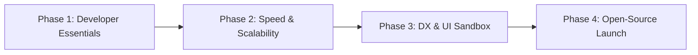

# Developer-First Open-Source Web Scraper: Roadmap & Improvement Report

> **Vision:** A free, self-hosted, zero-login, and developer-first web scraper and crawler — designed as an open-source local alternative to hosted services like Firecrawl and Jina Reader.

---

## 1. Executive Summary

Modern developers building AI chatbots, Retrieval-Augmented Generation (RAG) pipelines, dataset collectors, and developer tools need clean web data without paying high SaaS fees, creating API accounts, or leaking proprietary internal URLs to third-party scrapers.

This application already has strong fundamentals:
- **Clean UI & CLI dual-mode**: Easy configuration for both terminal enthusiasts and visual users.
- **Polite crawling**: Domain rate limiting and `robots.txt` enforcement.
- **Real-time feedback**: Server-Sent Events (SSE) streaming live crawl progress and logs.
- **Local Playwright fallback**: Headless rendering when pure HTTP responses lack content.

To transition this project into a top-tier, community-loved **open-source developer tool**, it must expand from a generic "HTML-to-text" utility into a **flexible, high-throughput extraction engine** that produces LLM-ready Markdown/JSON, offers an instant single-page REST API, supports concurrent crawling, and can be imported as a native Python library with zero friction.

---

## 2. Current Architecture vs. Developer Expectations

| Feature Area | Current State | Open-Source Developer Standard |
| :--- | :--- | :--- |
| **Output Formats** | Plain text (`.txt`) + basic `index.json` | **Markdown (`.md`)**, structured **JSON / JSONL**, CSV, SQLite, LLM chunking |
| **Scraping Workflow** | Multi-page crawl job only | **Instant single-URL scraper** + multi-page crawler + sitemap ingestion |
| **Concurrency** | Sequential 1-by-1 synchronous fetch (~1 req/sec) | **Concurrent async / thread-pooled** with polite per-domain rate limiting |
| **URL Targeting** | Same-domain boolean only | **URL Glob & Regex patterns** (`include` / `exclude` paths) |
| **Content Extraction** | Generic body heuristic (drops boilerplate) | **CSS selector & XPath targeting**, Readability algorithm, metadata extraction |
| **Programmatic Usage** | CLI command or Flask web server | **Importable Python library** (`from web_scraper import scrape, crawl`) |
| **Anti-Bot Resilience** | Static User-Agent, plain requests | **Header rotation**, browser TLS fingerprinting (`curl_cffi`), proxy support |
| **Packaging & CI/CD** | Flat script structure, manual test | `pyproject.toml`, PyPI package, Docker Hub image, GitHub Actions CI |

---

## 3. High-Priority Features for Developers

### 3.1. Markdown & RAG-Ready Outputs (Critical for AI/LLM Builders)
The overwhelming majority of developers using web scrapers today are feeding content into LLMs or vector databases.
- **Markdown Export (`.md`)**: Convert HTML to clean GitHub-Flavored Markdown (retaining headings `#`, lists, tables, hyperlinks, code snippets, and bold text) using libraries like `html2text` or `markdownify`.
- **Rich Structured JSON / JSONL**: Export every page with structured metadata:
  ```json
  {
    "url": "https://docs.example.com/api",
    "title": "API Documentation",
    "description": "Meta description content",
    "author": "Jane Doe",
    "published_time": "2026-01-15T00:00:00Z",
    "markdown": "# API Documentation\n\n...",
    "text": "API Documentation...",
    "html": "<main>...</main>",
    "links": ["https://docs.example.com/auth"],
    "images": [{"src": "/logo.png", "alt": "Logo"}],
    "headings": ["Overview", "Authentication", "Endpoints"]
  }
  ```
- **Optional Token / Character Chunker**: Add an option to automatically split long articles into vector-ready chunks (e.g. 500-1000 tokens with 10% overlap).

---

### 3.2. Instant Single-Page Scrape API (Zero-Setup Alternative to Jina/Firecrawl)
Developers often need to scrape a single URL programmatically via `curl` or their own code without initiating a full background crawl job.
- **Synchronous Endpoint**: `POST /api/scrape`
  ```bash
  curl -X POST http://localhost:5000/api/scrape \
    -H "Content-Type: application/json" \
    -d '{"url": "https://example.com", "format": "markdown", "render_js": false}'
  ```
  Returns the extracted Markdown or JSON payload immediately in the HTTP response.
- **UI "Quick Test" / Playground**: A single-URL sandbox tab in the Web UI where developers paste any link and immediately inspect the extracted Markdown, text, and JSON side-by-side.

---

### 3.3. Advanced URL Filtering (Globs & Regex)
Crawling entire domains often wastes time and bandwidth scraping useless sections (e.g., tags, auth pages, carts, login, archives).
- **Include Patterns**: Only follow URLs matching specific patterns (e.g., `*/docs/*`, `*/blog/2026/*`).
- **Exclude Patterns**: Ignore matching URLs (e.g., `*login*`, `*cart*`, `*/tag/*`, `*.pdf`).
- Both CLI flags (`--include-pattern`, `--exclude-pattern`) and UI input fields.

---

### 3.4. Targeted Extraction: CSS Selectors & XPath
Many developers only care about a specific container on a web page (e.g., `#main-content`, `article.post`, `.markdown-body`), or want to exclude specific UI widgets (e.g., `.advertisement`, `.cookie-banner`, `aside.sidebar`).
- Support `target_selector`: Extract only within specified CSS selector.
- Support `exclude_selectors`: Comma-separated list of elements to strip before extraction.
- Support structured schema extraction (e.g., extracting product price, title, image via CSS selector dictionary).

---

### 3.5. Sitemap.xml Auto-Detection & Ingestion
- When given a seed URL (e.g., `https://example.com`), automatically inspect `https://example.com/sitemap.xml` and `robots.txt` for sitemaps.
- Provide a toggle `--sitemap` to crawl directly from the sitemap. This is **10x faster and cleaner** than crawling HTML links, as it avoids navigation loops, duplicate query parameters, and irrelevant pages.

---

## 4. Performance & Core Engine Upgrades (Zero-Cost Optimization)

### 4.1. Concurrency with Polite Per-Domain Rate Limiting
- **Current bottleneck:** The current crawler fetches sequentially. Crawling 100 pages with a 1-second delay takes a minimum of 100 seconds.
- **Improvement:**
  - Implement concurrent workers (via `asyncio` + `httpx`, or a `ThreadPoolExecutor`).
  - Use a **token bucket** or **per-domain lock** so each individual domain respects the 1-second politeness delay, but different domains or sub-paths can be crawled concurrently.
  - Reduces a 100-page crawl time from ~120s down to ~15-20s while remaining completely respectful to target servers.

### 4.2. Lightweight Anti-Bot Resilience & TLS Impersonation
- Many modern websites block standard Python `requests` due to default TLS fingerprints (JA3/JA4) or missing browser headers.
- **Improvements:**
  - Add realistic browser request headers (User-Agent rotation, `Sec-CH-UA`, `Accept-Language`, `Sec-Fetch-Dest`).
  - Integrate `curl_cffi` as an optional high-performance fetcher: it impersonates real browser TLS handshakes (Chrome/Safari) without needing to spin up a heavy headless browser.
  - Add proxy support (`--proxy http://...`, `--proxy socks5://...`) to allow developers to route through their own local Tor or proxy servers if needed.

### 4.3. Resource-Smart Headless Browser Strategy
- Playwright Chromium takes ~300 MB disk space and 100 MB+ RAM per instance. On free cloud hosts (Render 512MB RAM), multiple Playwright instances can trigger Out-Of-Memory (OOM) crashes.
- **Improvements:**
  - Make Playwright strictly optional and lazy-loaded.
  - Implement a single reusable browser process with page reuse rather than recreating browser contexts frequently.
  - Configurable page timeouts and selective asset blocking (CSS, media, fonts, tracking scripts).

---

## 5. Developer Experience (DX) & Usability Improvements

### 5.1. Native Python Package & SDK
Make the core functionality importable directly into developer scripts:
```python
from website_scraper import Scraper, Crawler

# Instant single-page scrape
result = Scraper.scrape("https://example.com", format="markdown")
print(result.markdown)

# Multi-page crawl
crawler = Crawler(depth=2, max_pages=50, output_format="jsonl")
for page in crawler.crawl("https://example.com"):
    print(page.title, page.url)
```

### 5.2. CLI Enhancements
- **Pipe-Friendly Output**:
  - `python main.py --url https://example.com --stdout --format markdown` (pipe directly into tools like `pandoc`, `grep`, or an LLM prompt CLI).
  - `python main.py --url https://example.com --json | jq .`
- **Dry-Run Mode (`--dry-run`)**:
  - Discover and print the list of target URLs that would be crawled without actually downloading page bodies.
- **Config File Support**:
  - Read crawl presets from a `.scraperrc` or `scraper.json` file in the working directory.

### 5.3. Webhook Notifications
- Allow developers to provide a webhook URL (`--webhook http://localhost:8000/api/ingest`).
- When a crawl finishes, POST a summary payload (or individual page events) to their application backend, enabling seamless RAG ingestion pipelines.

---

## 6. Open-Source Readiness & Community Growth

To attract open-source contributors and GitHub stars, the repository needs standard open-source hygiene:

1. **Permissive License**:
   - Add an **MIT License** or **Apache 2.0 License** so developers and startups can freely use it in their software stacks without legal friction.
2. **Modern Python Packaging**:
   - Add `pyproject.toml` (standard PEP 621 / Hatch / Flit) allowing `pip install web-scraper` or `pipx run web-scraper`.
3. **One-Command Docker Hub Deployment**:
   - Provide a pre-built multi-architecture Docker image (`linux/amd64`, `linux/arm64` for Apple Silicon):
     ```bash
     docker run -d -p 5000:5000 -v $(pwd)/output:/app/output ghcr.io/yourusername/web-scraper:latest
     ```
4. **CI/CD & Code Quality**:
   - Setup GitHub Actions workflow for automated testing (`pytest`), linting (`ruff`), and type checking (`mypy`).
   - Add test coverage for complex edge cases (canonical redirects, relative link resolution, malformed HTML, robots.txt parsing).
5. **Community Documentation**:
   - `CONTRIBUTING.md` with local dev setup instructions.
   - Example recipes in `/examples`:
     - `examples/rag_langchain.py`: Scrape docs and index into LangChain vector store.
     - `examples/llama_index.py`: Scrape blog and query with LlamaIndex.
     - `examples/single_curl.sh`: Shell script scraping via the REST API.

---

## 7. Actionable Implementation Roadmap



### Phase 1: High-Impact Developer Essentials (Weeks 1–2)
- [ ] Add **Markdown (`.md`)** extraction and export using `html2text` / `markdownify`.
- [ ] Add **Single-URL instant scrape API** (`POST /api/scrape`) with JSON/Markdown response.
- [ ] Implement URL path filtering (`--include-pattern`, `--exclude-pattern`).
- [ ] Add CSS selector targeting (`--selector`, `--exclude-selector`).
- [ ] Create permissive open-source `LICENSE` (MIT) and `pyproject.toml`.

### Phase 2: Performance & Engine Upgrades (Weeks 3–4)
- [ ] Convert crawler fetch pipeline to concurrent worker pool (Async / ThreadPool).
- [ ] Add `sitemap.xml` parser for rapid seed population.
- [ ] Integrate `curl_cffi` for lightweight TLS browser impersonation.
- [ ] Support `--stdout` and `--json` pipeable CLI outputs.

### Phase 3: Web UI Playground & Advanced Options (Weeks 5–6)
- [ ] Add "Quick Scrape Playground" in UI for single-page live testing.
- [ ] Add Selector Tester with live preview in UI.
- [ ] Provide format selector in UI (Download ZIP as Markdown, TXT, or JSONL).
- [ ] Add optional Webhook completion callback.

### Phase 4: Packaging, Integrations & Open-Source Release (Weeks 7–8)
- [ ] Setup GitHub Actions CI (linting, tests, multi-OS builds).
- [ ] Publish official Docker container to GitHub Container Registry (`ghcr.io`).
- [ ] Create LangChain and LlamaIndex ingestion examples in `/examples`.
- [ ] Launch on GitHub with interactive demo GIF and comprehensive documentation.

---

## 8. Summary of Benefits

By implementing this roadmap, this project will become:
1. **100% Free & Self-Hosted**: No credit cards, no monthly subscription fees, no rate limits.
2. **Zero Login / Zero Setup**: Run via single Docker command or single CLI command in seconds.
3. **The Go-To RAG Ingestion Tool**: Clean markdown output ready for any modern vector database and LLM framework.
4. **Fast and Polite**: High-throughput concurrent crawling that respects target servers.
