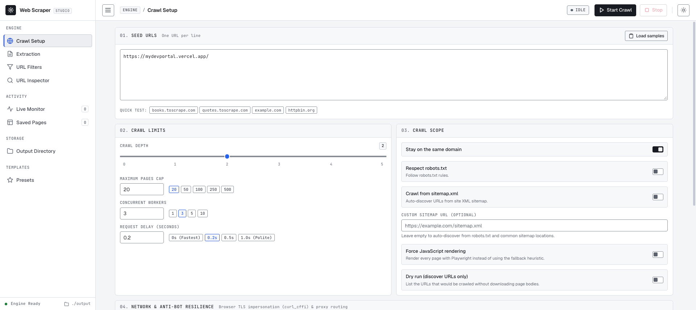
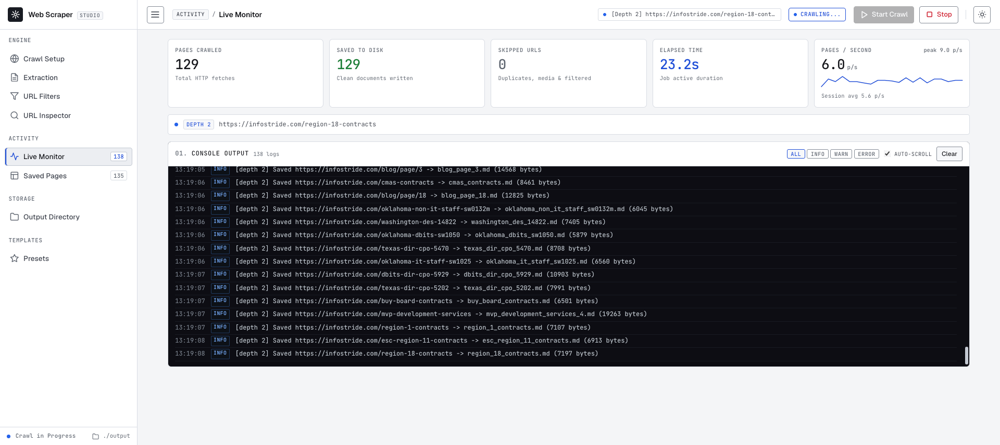

# Website Content Scraper

A free, self-hosted, developer-first web scraper and crawler. It follows links to a configurable depth and saves clean **text, Markdown, JSON, or JSONL** locally — no accounts, no hosted scraping APIs, no per-request fees. It includes both a command-line interface (CLI) and a minimalist web UI.

Typical uses: feeding documentation into an LLM/RAG pipeline, collecting a dataset, archiving a site, or testing selectors and URL filters against a real page.




## Features

- **RAG-ready Markdown** with headings, lists, links, tables, images, and code blocks preserved.
- **Structured JSON / JSONL** with title, description, author, publish date, canonical URL, links, images, headings, and optional chunks.
- **CSV and SQLite output** (`pages.csv`, `pages.db`) for spreadsheets, pandas, and SQL analysis.
- **Instant single-page scrape API** (`POST /api/scrape`) for `curl` and application code.
- **URL filtering** with shell globs or regular expressions (`include` / `exclude`).
- **Targeted extraction** using CSS or XPath selectors, plus selectors to strip ads, sidebars, and cookie banners.
- **Custom schema extraction** via a JSON selector map (e.g. product title, price, images) saved with every page.
- **Polite crawling**: per-domain pacing and `robots.txt` enforcement.
- **JavaScript rendering** via a lazily loaded, reusable local Playwright browser (optional).
- **Live progress** in the web UI over Server-Sent Events (SSE).

## Install

```bash
python3 -m venv .venv
source .venv/bin/activate
pip install -r requirements.txt

# Optional: enable JavaScript rendering for React/Vue/Next.js pages
playwright install chromium
```

Or install the project as a package (adds the `website-scraper` command):

```bash
pip install -e .
```

## Run with Docker

No Python setup needed. The image bundles Python, all dependencies, and Chromium
for JavaScript rendering. Build it from this folder:

```bash
docker build -t website-scraper .
docker run -d --name website-scraper \
  -p 5000:5000 \
  -v "$(pwd)/output:/app/output" \
  website-scraper
```

Open **`http://localhost:5000`**. Scraped files appear in `./output` on your machine.

Prebuilt images are also published for Intel/AMD and Apple Silicon:

```bash
docker pull devansh-kumar-saini/website-scraper:latest   # Docker Hub
docker pull ghcr.io/devansh-kumar-saini/web-scrapper:latest  # GitHub Container Registry
```

Run the CLI or Docker Compose:

```bash
# CLI inside the container
docker run --rm -v "$(pwd)/output:/app/output" website-scraper \
  python main.py --url https://example.com --format md --depth 1

# Or with Docker Compose
docker compose up -d --build
```

See [docs/DOCKER.md](docs/DOCKER.md) for the full guide, including how to publish your own
free image and automate multi-architecture builds.

## Command-Line Interface (CLI)

```bash
# Plain text output (default)
python main.py --url https://example.com --depth 1

# Markdown output, ready for an LLM/RAG pipeline
python main.py --url https://docs.example.com --format md --output-dir ./scraped-docs

# Only follow docs links, skip login/cart/tag pages
python main.py --url https://example.com --depth 3 \
  --include-pattern "*/docs/*" --exclude-pattern "*login*" --exclude-pattern "*cart*"

# Extract only the article body and strip UI chrome
python main.py --url https://blog.example.com/post --format md \
  --selector "article" --exclude-selector "aside, .advertisement, .cookie-banner"

# XPath selectors (prefix with xpath: or start with //)
python main.py --url https://example.com --format md \
  --selector "xpath://main" --exclude-selector "//nav"

# Structured schema extraction into a custom set of fields
python main.py --url https://shop.example.com/product --format json \
  --schema '{"title": "h1", "price": {"selector": ".price", "attr": "content"}, "images": {"selector": ".gallery img", "attr": "src", "all": true}}'

# CSV or SQLite output
python main.py --url https://docs.example.com --format csv --output-dir ./dataset
python main.py --url https://docs.example.com --format sqlite --output-dir ./dataset

# JSONL with overlapping chunks for a vector database
python main.py --url https://docs.example.com --format jsonl --chunk-size 4000 --chunk-overlap 400

# Multiple seeds and a custom page cap
python main.py --url https://a.com,https://b.com --depth 2 --max-pages 50

# Allow outbound links
python main.py --url https://example.com --depth 2 --no-same-domain

# Launch the web UI
python main.py --ui --port 8080

# Interactive mode (prompts for settings)
python main.py
```

### CLI Options

| Flag | Description | Default |
|---|---|---|
| `--url` | Target URL(s); repeat the flag or separate with commas | Interactive if omitted |
| `--depth` | Traversal depth limit (0 to 5) | `1` |
| `--max-pages` | Maximum pages to fetch | `100` |
| `--same-domain` / `--no-same-domain` | Restrict crawling to seed domain(s) | `True` |
| `--format` | Output format: `txt`, `md`, `json`, `jsonl`, `csv`, `sqlite` | `txt` |
| `--include-pattern` | Only follow URLs matching a glob or `re:` regex; repeatable | None |
| `--exclude-pattern` | Skip URLs matching a glob or `re:` regex; repeatable | None |
| `--selector` | Extract only within the first matching CSS or XPath selector | Whole page |
| `--exclude-selector` | Strip matching CSS or XPath elements before extraction; repeatable | None |
| `--schema` | JSON map of custom fields to selectors | None |
| `--schema-file` | Path to a JSON file containing a schema selector map | None |
| `--chunk-size` | Emit chunks of this many characters; `0` disables | `0` |
| `--chunk-overlap` | Overlap between chunks in characters | `400` |
| `--respect-robots` / `--no-respect-robots` | Enforce `robots.txt` | `True` |
| `--concurrency` | Concurrent fetch workers | `5` |
| `--delay` | Per-domain politeness delay in seconds | `0.2` |
| `--sitemap` / `--no-sitemap` | Discover URLs from `sitemap.xml` | `False` |
| `--sitemap-url` | Explicit sitemap URL to crawl | None |
| `--impersonate` | `curl_cffi` TLS fingerprint (`chrome`, `safari`, `firefox`, `none`) | None |
| `--proxy` | Route requests through an HTTP/SOCKS proxy | None |
| `--stdout` | Print extracted content to stdout (pipe-friendly) | `False` |
| `--json` | Print the structured JSON document to stdout | `False` |
| `--render-js` | Force Playwright rendering for every page | `False` |
| `--dry-run` | List target URLs without downloading page bodies | `False` |
| `--webhook` | POST a crawl summary to this URL when the job finishes | None |
| `--config` | Load defaults from `.scraperrc` / `scraper.json` | None |
| `--output-dir` | Folder for output files | `./output` |
| `--ui` | Launch the web UI | `False` |
| `--port` | Web UI port | `5000` |
| `--host` | Web UI host | `127.0.0.1` |

### URL pattern syntax

Patterns are shell globs matched against the full URL and its path:

- `*/docs/*` — documentation paths on any domain.
- `*login*`, `*cart*`, `*/tag/*`, `*.pdf` — common exclusions.
- `re:/docs/\d+$` — use a Python regular expression by prefixing with `re:`.

Exclude patterns always win over include patterns. Filters apply to discovered links; seed URLs are always crawled. Same-domain filtering still applies when enabled.

## Instant Single-Page Scrape API

Start the server (`python main.py --ui`) and scrape one URL synchronously — no crawl job, no polling:

```bash
curl -X POST http://localhost:5000/api/scrape \
  -H "Content-Type: application/json" \
  -d '{"url": "https://example.com", "format": "markdown"}'
```

The response is `text/markdown` by default. Set `"format": "json"` for the full structured payload, `"text"` for readable text, or `"html"` for the extracted container HTML (served as plain text).

GET works too, which is convenient for shell pipelines:

```bash
curl "http://localhost:5000/api/scrape?url=https://example.com&format=markdown" | head -40
curl "http://localhost:5000/api/scrape?url=https://example.com&format=json" | jq .title
```

Request parameters:

| Field | Description | Default |
|---|---|---|
| `url` | Page to scrape (required) | — |
| `format` | `markdown`, `text`, `json`, `html` | `markdown` |
| `render_js` | Render with local Playwright Chromium | `false` |
| `selector` / `target_selector` | Extract only inside this CSS or XPath selector | Whole page |
| `exclude_selectors` | String or list of CSS/XPath selectors to strip | None |
| `schema` | Object or JSON string mapping custom fields to selectors | None |
| `chunk_size` / `chunk_overlap` | Include overlapping chunks in JSON output | `0` / `400` |
| `respect_robots` | Enforce `robots.txt` | `true` |

Error responses are JSON with `error` and `code` fields (`robots_disallowed`, `non_html`, `fetch_failed`, `timeout`).

### Batch crawl API

The existing job API is unchanged:

| Endpoint | Method | Purpose |
|---|---|---|
| `/api/scrape/start` | POST | Start a background crawl |
| `/api/scrape/stop` | POST | Stop the active crawl |
| `/api/scrape/status` | GET | Current job snapshot |
| `/api/scrape/events` | GET | SSE progress/log stream |
| `/api/results` | GET | List saved pages from `index.json` |
| `/api/results/file` | GET | Preview one saved file |
| `/api/results/download` | GET | Download output directory as ZIP (`?format=md\|txt\|json\|jsonl\|csv\|sqlite` converts first) |
| `/api/results/clear` | POST | Delete files in the output directory |

`POST /api/scrape/start` also accepts `format`, `include_patterns`, `exclude_patterns`, `target_selector`, `exclude_selectors`, `schema`, `chunk_size`, `chunk_overlap`, `concurrency`, `delay`, `sitemap`, `proxy`, and `webhook_url`. A configured webhook receives `crawl.completed`, `crawl.stopped`, or `crawl.failed` with page stats and saved file metadata.

## Python Library

The core is importable without going through the CLI or server:

```python
from Backend import Crawler, scrape_url

# Instant single-page scrape
document = scrape_url(
    "https://docs.example.com/api",
    target_selector="article",
    exclude_selectors=[".advertisement"],
    schema={
        "title": "h1",
        "price": {"selector": ".price", "attr": "content"},
        "images": {"selector": ".gallery img", "attr": "src", "all": True},
    },
)
print(document.markdown)
print(document.schema)
print(document.to_dict())

# Multi-page crawl
crawler = Crawler(max_depth=2, max_pages=50, same_domain=True, logger=__import__("logging").getLogger())
for page in crawler.crawl(["https://example.com"]):
    print(page.depth, page.url, page.title)
```

## Web UI

```bash
python main.py --ui
```

Open **`http://127.0.0.1:5000`**.

UI features:

- Seed URLs, depth slider, page cap, and same-domain toggle.
- **Advanced extraction** panel for output format, content/exclude selectors (CSS or XPath), schema fields, and include/exclude URL patterns.
- **Single URL Inspector** with live selector preview: tweak target/exclude CSS or XPath selectors and schema JSON, and the Markdown, text, JSON, and HTML tabs refresh automatically.
- Live cached/saved/skipped counters and a streamed log console.
- Click any saved page to preview its extracted content (works for TXT, Markdown, JSON, and CSV).
- ZIP download in the original format or converted on demand to Markdown, plain text, JSON, JSONL, CSV, or SQLite.
- Optional webhook callback that POSTs a crawl summary to your own backend on completion.
- Native folder picker (macOS, Windows, Linux) when running locally.

## Output Formats

Every page gets a structured record in memory with these fields:

```json
{
  "url": "https://docs.example.com/api",
  "title": "API Documentation",
  "description": "Meta description",
  "author": "Jane Doe",
  "published_time": "2026-01-15T00:00:00Z",
  "canonical_url": "https://docs.example.com/api",
  "markdown": "# API Documentation\n\n...",
  "text": "API Documentation...",
  "html": "<article>...</article>",
  "links": ["https://docs.example.com/auth"],
  "images": [{"src": "https://docs.example.com/logo.png", "alt": "Logo"}],
  "headings": ["API Documentation", "Authentication"],
  "chunks": [],
  "schema": {"title": "API Documentation", "price": null},
  "word_count": 412,
  "status_code": 200,
  "selector_matched": true
}
```

| `--format` | Files written |
|---|---|
| `txt` | `<page>.txt` with a metadata header and readable text |
| `md` | `<page>.md` with YAML front matter and GitHub-Flavored Markdown |
| `json` | `<page>.json` with the full structured record |
| `jsonl` | `pages.jsonl`, one JSON record per line |
| `csv` | `pages.csv`, one row per page (lists and schema stored as JSON) |
| `sqlite` | `pages.db` with a `pages` table (query with any SQLite client) |

The output directory also contains `index.json` (manifest of saved pages) and `scrape_log.txt` (crawler events and skipped-resource reasons).

### Schema extraction

`--schema` (or `schema` in the API/library) maps custom field names to selectors:

```json
{
  "title": "h1",
  "price": {"selector": ".price", "attr": "content"},
  "gallery": {"xpath": "//div[@class='gallery']//img", "attr": "src", "all": true}
}
```

- A plain string is treated as a selector and returns the element text.
- Objects accept `selector`, `css`, or `xpath`, plus optional `attr` (read an attribute and resolve `href`/`src` against the page URL) and `all` (return every match as a list).
- XPath is used automatically when the selector starts with `xpath:`, `//`, `.//`, `(//`, `(.//`, or `./`.
- Results are stored in the page's `schema` field and as a JSON column in CSV/SQLite output.

### Chunking

`--chunk-size` is measured in characters, not tokens (a rough approximation is four characters per token). Chunks split on paragraph boundaries when possible and include `--chunk-overlap` characters of context from the previous chunk. A size of `4000` with an overlap of `400` is a practical starting point for RAG.

The test suite covers the folder picker and output directory handling plus phases 1–3: Markdown/metadata extraction, CSS and XPath selectors, schema extraction, URL filters, all output formats (including CSV/SQLite conversion), robots.txt handling, the single-page API, and webhooks.

## License

MIT — see [LICENSE](LICENSE).
